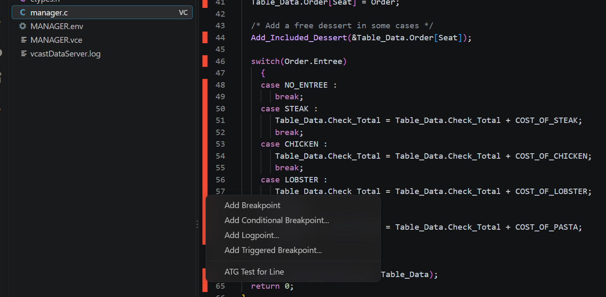
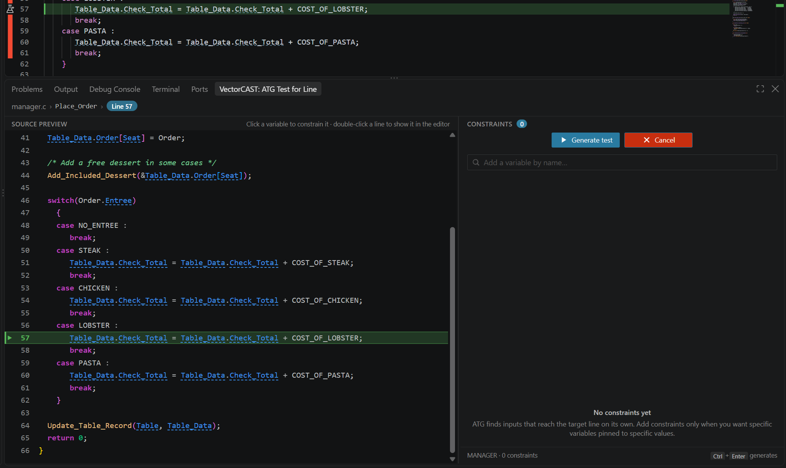
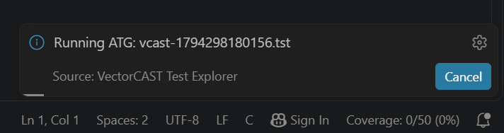
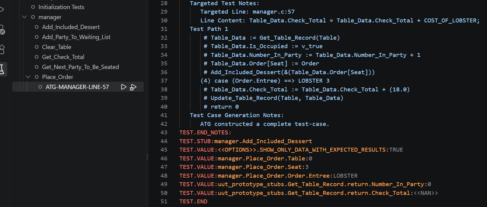
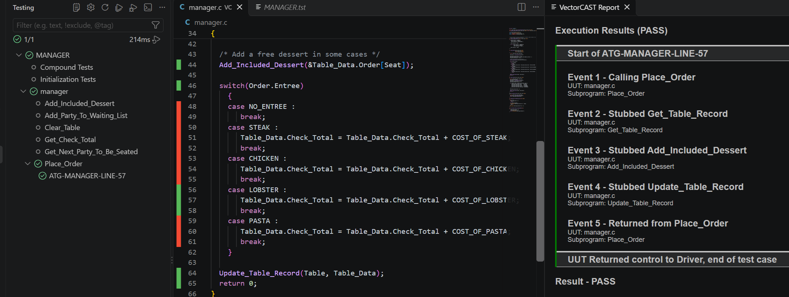
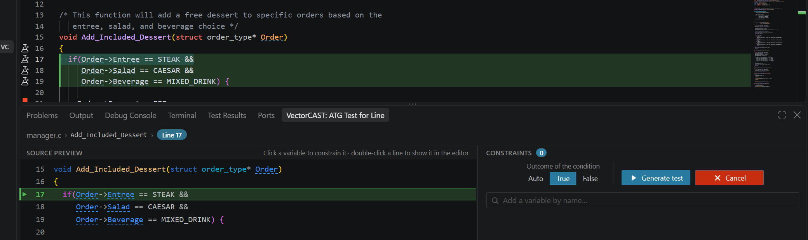
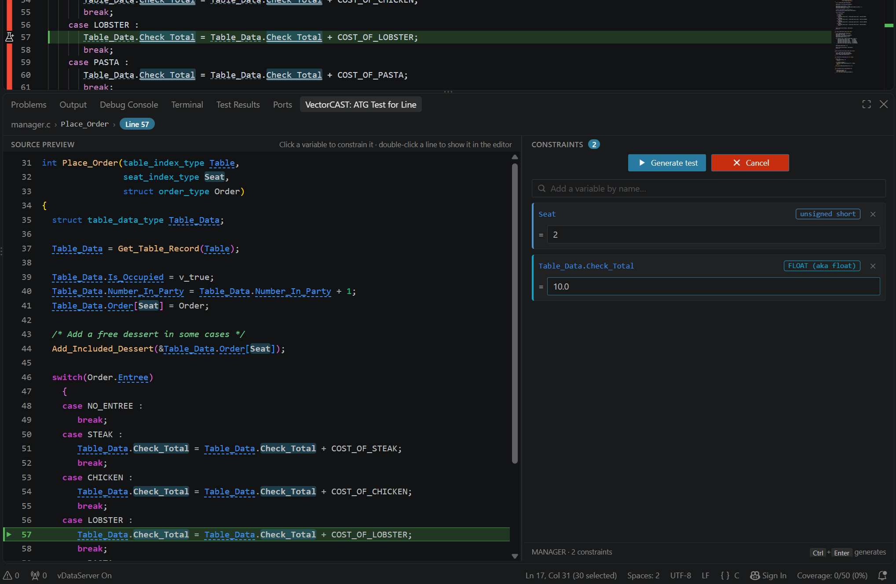
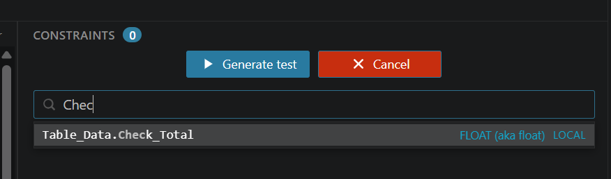

# VectorCAST ATG Test for Line Documentation and Tutorial

## Overview

**ATG Test for Line** (also known as **Get Me Here**) generates a VectorCAST test case that reaches a specific line of your source code. You pick the line, and VectorCAST's Automatic Test Generation (ATG), guided by a large language model, works out the inputs needed to get execution there.

With it you can:

- **Reach an uncovered line** with a single right-click
- **Choose the outcome of a condition**, so the test takes either the true or the false side of a decision
- **Pin variables to specific values** (parameters, globals, and locals filled by stubs or other functions) when you want the test to reach the line in a particular way

The generated test is an ordinary VectorCAST test case: it appears in the Test Explorer, and you can run, edit, and inspect its coverage like any other test.

This manual demonstrates ATG Test for Line from inside this VS Code extension using the same `TUTORIAL_C` demo environment as the [Reqs2x tutorial](../reqs2x/reqs2x_documentation.md).

## 1. Setup and Installation

ATG Test for Line uses the same installation, LLM provider configuration and demo environment as Reqs2x. Follow these sections of the Reqs2x documentation first:

1.  [Prerequisites](../reqs2x/reqs2x_documentation.md#prerequisites) and [VS Code Extensions](../reqs2x/reqs2x_documentation.md#vs-code-extensions)
2.  [Configuration](../reqs2x/reqs2x_documentation.md#configuration): set up the LLM provider settings (**Vectorcast Test Explorer › Reqs2x: Provider** and that provider's fields)
3.  [Environment Setup](../reqs2x/reqs2x_documentation.md#environment-setup): set the configuration file and build `TUTORIAL_C`

**Notes** on what is specific to ATG Test for Line:

*   **ATG support**: your VectorCAST installation must include a licensed `atg` that supports LLM-guided path search. The `atg` shipped with VectorCAST 2026 and earlier does not. The extension checks the installed `atg` when it starts, and only shows the **ATG Test for Line** menu entry if it qualifies.
*   **LLM provider**: ATG Test for Line uses the provider selected in **Vectorcast Test Explorer › Reqs2x: Provider** and that provider's fields, exactly like the Reqs2x tools. Every Reqs2x provider is supported.
*   **Other Reqs2x settings**: the options that shape the LLM connection apply too, for example **Model Compatibility Mode** and **Output Debug Info**. The test-generation options, such as **Decompose Requirements** or **Retries**, do not.
*   **Enable Reqs2x Feature**: does not have to be ticked. When it is, ATG Test for Line checks your provider settings before every run, as Reqs2x does, and shows an error with an **Open Settings** button if they are incomplete or the provider cannot be reached.
*   **Coverage**: the environment must be built with coverage instrumentation (the `TUTORIAL_C` demo uses statement coverage). The extension uses the coverage data to decide which lines ATG can target.

---

## 2. Generating a Test for a Line

In this section we generate a test that reaches the lobster case of `Place_Order` in `manager.c`, without telling ATG anything else.

### Starting ATG Test for Line
1.  Click the **Flask icon** (Test Explorer) on the left sidebar to make sure `TUTORIAL_C` is loaded.
2.  Open `manager.c` and scroll to `Place_Order`.
3.  Right-click the **line number** of line 57 (`Table_Data.Check_Total = Table_Data.Check_Total + COST_OF_LOBSTER;`) in the editor gutter and select **ATG Test for Line**.
    *   **Note**: The entry only appears on lines ATG can target, which are statement and branch lines. Blank lines, comments and declarations do not offer it.

### The ATG Test for Line Panel
The **VectorCAST: ATG Test for Line** panel opens at the bottom of the window, and the target line is highlighted in green in the editor.

*   **Breadcrumbs** at the top show the file, function and target line. Click the line to jump to it in the editor.
*   **Source preview** on the left shows the function with the target line marked. Underlined identifiers are variables you can constrain (see [Section 4](#4-constraining-variables)). Double-click a line to show it in the editor.
*   **Constraints** on the right lists the variables you have pinned. It starts empty: ATG finds inputs that reach the target line on its own.
*   The **status bar** shows `ATG line 57 · 0 constraints`. Click it for a quick **Generate** / **Cancel** menu.

### Test Generation
1.  Click **Generate test** in the panel (or press `Ctrl+Enter`).
    *   The panel closes and a progress notification appears. You can cancel generation from the notification.
2.  Monitor progress: open the **OUTPUT** pane and select **VectorCAST Test Explorer** from the dropdown. The ATG command and its output are logged there.

### Reviewing Results
1.  **Find the test**: When generation finishes, the new test is loaded into the environment and revealed in the Test Explorer under `Place_Order`. It is named after the unit and target line, for example `ATG-MANAGER-LINE-57`.
2.  **Inspect the test**: Right-click the test and select **VectorCAST -> Edit Test Script**.
    *   Observe that ATG chose `LOBSTER` as the value of `Order.Entree`, which is what the `switch` needs to reach line 57.
    *   The `TEST.NOTES` record the targeted line and its content, and the **Test Path** ATG took to reach it, for example `case (Order.Entree) ==> LOBSTER`.

### Execution and Coverage
1.  Click the **Run** button next to the new test. The execution report opens and shows the test passing.
2.  Look at the gutter of `manager.c`: line 57 is now covered.
    *   **Note**: The generated test is no different from a manually-created `tst` test. You can edit it, re-run it and open it in the VectorCAST GUI like any other test.

---

## 3. Choosing the Outcome of a Condition

When the target line is a decision (an `if`, `else if`, `while`, `for`, `switch` or `?:` line), you can choose which way the condition should go.

1.  In `manager.c`, right-click the line number of line 17 (`if(Order->Entree == STEAK &&`) in `Add_Included_Dessert` and select **ATG Test for Line**.
    *   The condition spans lines 17-19, so the whole condition is highlighted in the editor.
2.  The panel now shows **Outcome of the condition** with three options:
    *   **Auto**: let ATG choose the outcome (default)
    *   **True**: reach the line with the condition true
    *   **False**: reach the line with the condition false
3.  Select **True** and click **Generate test**.
4.  Open the generated test with **VectorCAST -> Edit Test Script**. For the condition to be true, ATG has to choose `STEAK`, `CAESAR` and `MIXED_DRINK` for the order. Running the test covers line 21, where the free pie is added.
5.  Repeat with **False** to get a test that skips the free pie.

---

## 4. Constraining Variables

Sometimes you want the test to reach the line in a particular way, for example for a specific seat or a specific running total. You can pin variables to values, and ATG will find the remaining inputs around them.

### Adding Constraints
1.  Right-click the line number of line 57 in `Place_Order` again and select **ATG Test for Line**.
2.  **From the code**: In the source preview (or directly in the editor), click `Seat` on line 41. It is added to **Constraints** as a parameter. Enter `2` as its value.
3.  **By name**: Click the **Add a variable by name…** box and type `Check`. Each match shows its type and whether it is a parameter, global or local. Pick `Table_Data.Check_Total` and enter `10.0` as its value.
    *   **Note**: `Table_Data` is a local variable filled by the stubbed `Get_Table_Record`, so pinning it constrains the stub's return value. Locals are discovered in the background and can take a few seconds to appear after the panel opens.
4.  Click **Generate test**.
5.  Open the generated test with **VectorCAST -> Edit Test Script**. Observe that `Seat` is `2` and that the stub for `Get_Table_Record` returns a `Check_Total` of `-8.0`. Line 57 adds `COST_OF_LOBSTER` (18) to it, so `Check_Total` is `10.0` once the target line has run.
    *   **Note**: A constraint is the value the variable ends up with at the target line, not the value it starts with. ATG works backwards to the inputs that produce it.

### What Can Be Constrained
*   **Parameters** of the function under test
*   **Globals** used by the function
*   **Locals** that are filled by a stubbed function or another function in the unit under test. Other locals cannot be driven by a test, so they are not offered.
*   Struct fields (for example `Table_Data.Check_Total`) and array elements. Structs passed by value cannot be constrained as a whole, only through their fields.

### Entering Values
The value field adapts to the variable's type:

| Type | Input |
| --- | --- |
| Enum | Dropdown of the enum's values, or **any value** |
| Bool | **any** / **true** / **false** |
| Array | One row per element: `name[index] = value`. Click **+ Add another index** to pin more elements. If you clicked the array on a line where it is indexed (for example `Order[Seat]`), that index is filled in for you. |
| Other | Free text, for example `42`, `1.5` or `"abc"` |

To remove a constraint, click the **×** on its card, or click the variable in the code again.

---

## 5. Reference

### Cancelling
Any of these leaves ATG Test for Line without generating a test:
*   Click **Cancel** in the panel
*   Close or hide the panel
*   Click the status bar item and select **Cancel ATG Test for Line**
*   Run **VectorCAST Test Explorer: Cancel ATG Test for Line** from the Command Palette

### Changing the Target Line
The target line is fixed for a session. To target a different line, right-click its line number and select **ATG Test for Line** again. This starts a new session and clears the constraints.

Editing the file while the panel is open is fine: the source preview and the clickable variables follow your changes.

### Troubleshooting
*   **The ATG Test for Line entry is missing from the menu**:
    *   Make sure you right-clicked the **line number**, not the code.
    *   The line must be a statement or branch line in a file that belongs to a built environment with coverage.
    *   The VectorCAST installation must contain a licensed `atg` that supports LLM-guided path search. At startup the **VectorCAST Test Explorer** output channel logs the `atg` license check, followed by either `'atg' supports LLM_PATHS, line test is available` or `'atg' does NOT support LLM_PATHS, line test is not available`.
*   **No locals are offered**: local variable discovery needs the language server bundled with VectorCAST. If it cannot start, only parameters and globals are offered, and the reason is logged as `ATG Mode: local variables unavailable` in the **VectorCAST Test Explorer** output channel.
*   **Generation fails**: check the **VectorCAST Test Explorer** output channel for the ATG output, and check that your LLM provider settings are correct (see [Section 1](#1-setup-and-installation)). You can test them with **VectorCAST Test Explorer: Test if Reqs2X works with the current LLM configuration** from the Command Palette, which needs **Enable Reqs2x Feature** ticked.
